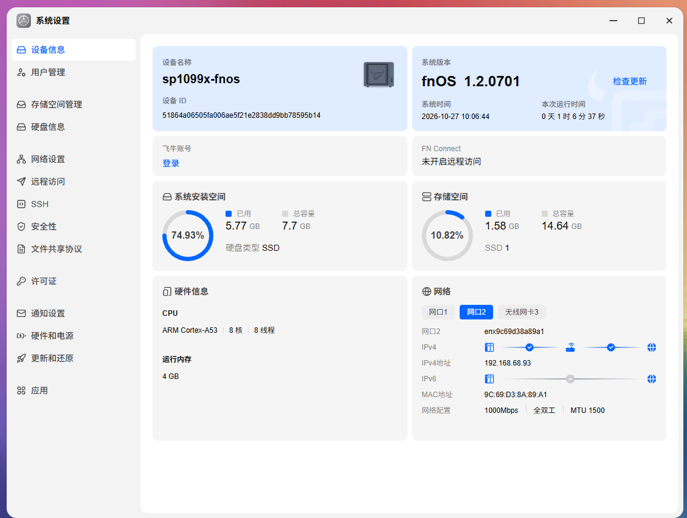
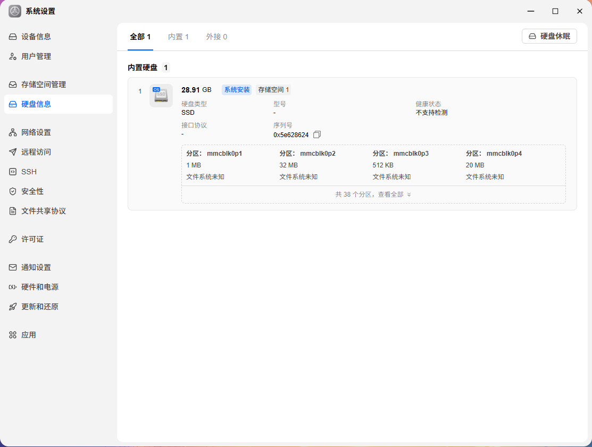
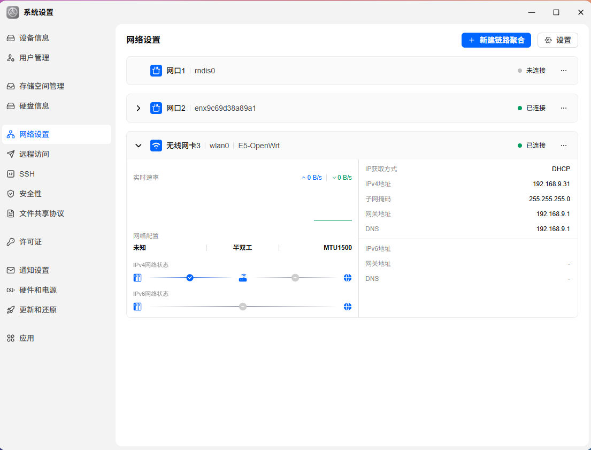
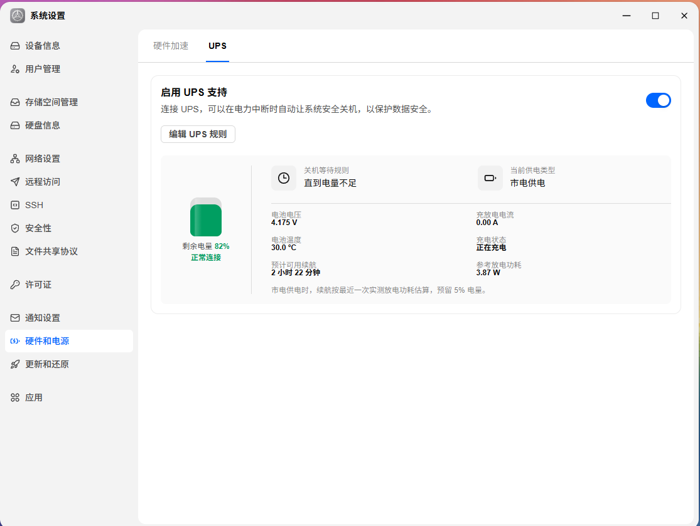
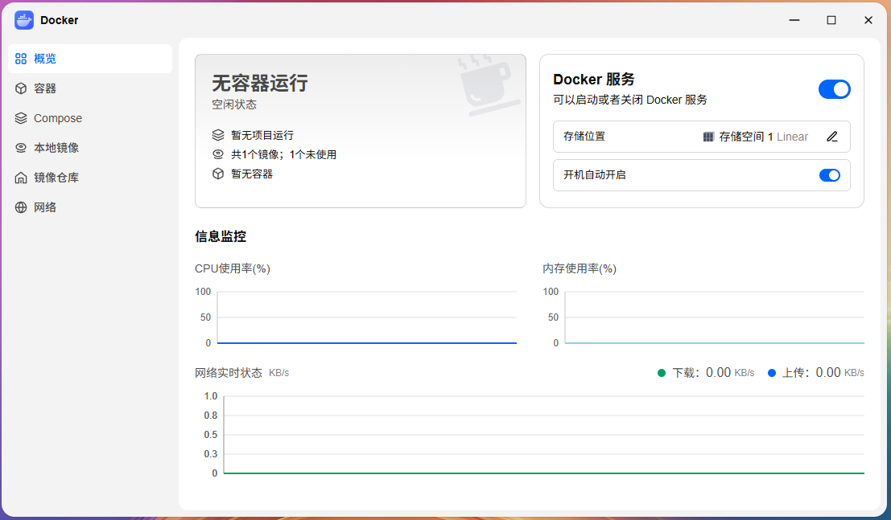
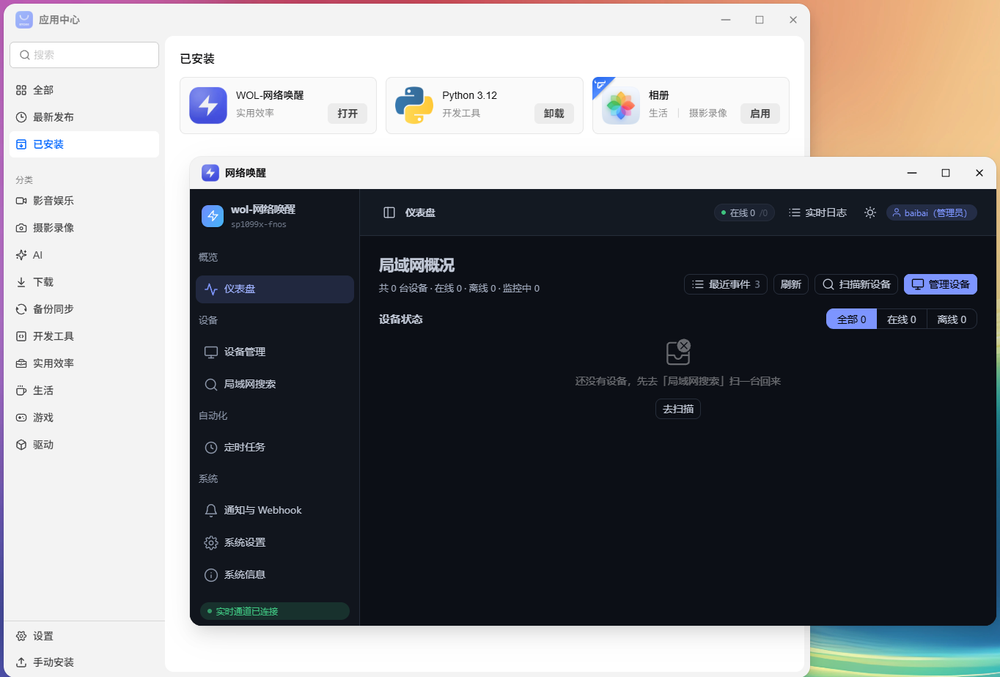
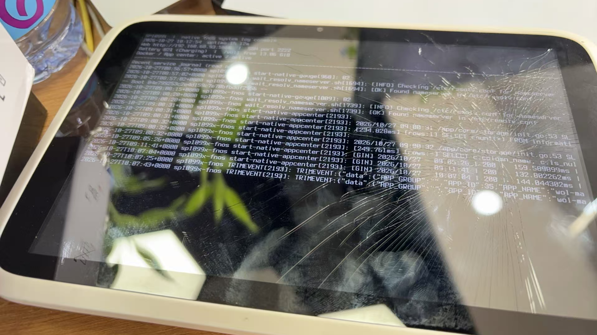

# SP1099X 原生飞牛 fnOS

针对同批次 SP1099X（MT6762V/CB / mt6765，4GB RAM / 32GB eMMC，Android 9）的原生 fnOS ARM 适配及 Windows 离线刷机工具。

**当前版本：r1-20261027 候选版。重新整理的全自动安装与回退流程尚未在第二台设备完成实刷验收。**

## 下载与文档

- [下载完整离线刷机包和 SHA-256 校验文件](https://github.com/BaiBaiAi/sp1099x-fnos/releases/tag/r1-20261027)（约 1.86 GB，包含 ADB、Fastboot、DLL、系统镜像、Windows 工具和完整组件源码）。
- [详细刷机说明：从已 root 的 Android 开始](docs/FLASHING-ZH.md)
- [验证范围与已知限制](docs/VALIDATION-ZH.md)
- [第三方组件与许可](docs/THIRD-PARTY.md)

GitHub 的绿色 Code → Download ZIP 只包含文档与可浏览源码，**不能作为刷机包使用**。请下载 Release 中的 SP1099X-fnOS-1.2.0701-r1-20261027.zip。完整 Linux 内核源码位于该离线包的 source/kernel-source.tar.gz；本仓库保留其余适配源码、配置和固定的 Go vendor 依赖。第三方组件保持各自许可，fnOS 闭源程序不以本项目开源代码名义发布。

## 使用条件

设备必须已 root 并解锁 Bootloader。工具严格核对原始分区布局、容量、DTBO 和原厂 Recovery 指纹，不提供跳过检查功能。安装会清空 Android 用户数据。仅接受同批次硬件，不适用于其他容量或面板版本。

只允许在纯英文 / ASCII 本地目录运行，例如 D:\SP1099X-fnOS；中文路径会在调用设备工具前被拒绝。工具使用自身目录中的依赖，不依赖制作电脑的盘符或全局 ADB。

开发设备已验证原生系统启动、文件管理、SMB、Docker、Wi-Fi、内置电池 UPS 和稳定的只读屏幕日志控制台。Wi-Fi 仍有少量重复回包，电源管理尚未完整优化；屏幕是日志显示，不是图形桌面。具体边界以验证文档为准。

## 离线包使用说明

版本：2026-10-27，fnOS ARM 1.2.0701，自编译板级 Linux 4.9.117 #19。

这是针对已获取 root、已解锁 Bootloader 的同批次 SP1099X 4GB/32GB 平板制作的社区候选包。系统本身及屏幕、网络、文件管理和 Docker 的适配已有开发设备实测；**这套重新整理的全自动安装/回退流程尚未在第二台设备完成实刷验收，不应称为量产稳定固件。**

先完整阅读 [详细刷机说明](docs/FLASHING-ZH.md)。只允许在纯英文/ASCII 本地目录运行，例如 `D:\SP1099X-fnOS`。程序位置、当前目录或备份路径包含中文/其他非 ASCII 字符时会直接退出。空格可用，仍建议使用简单短路径。

工具已经包含 ADB、Fastboot、所需 DLL、完整系统文件、安装环境、主启动镜像、Wi-Fi/状态/私有 SMB 配置功能。收件人不需要 Python、Go、WSL，也不需要沿用制作电脑的盘符。Windows 系统自带 PowerShell 和 USB 驱动框架仍是运行条件。

建议顺序：

1. 将整个 ZIP 解压到英文目录，不要直接在压缩包里运行。
2. 双击 `00-Verify.cmd` 检查包文件；此步骤无需设备。
3. 在平板 Android 中开启 USB 调试，USB 数据线连接电脑，只连接一台目标设备，电量至少 60%。
4. 运行 `01-Check.cmd`，按平板提示允许本工具的 USB 调试及 Magisk/su 请求。
5. 右键 `03-Install.cmd`，以管理员身份运行。它自带完整备份；不必事先重复运行 `02-Backup.cmd`。
6. 仔细阅读清空说明，输入工具显示的 `ERASE-设备序列号`。工具完成备份并逐分区核验后才开始刷写。
7. 完成后保持 USB 连接，等待首次启动，在 `http://192.168.77.1:5666` 创建自己的管理员。

**安装会清空 Android userdata，并重建其范围内的系统和 NAS 数据空间。备份不包含 Android userdata/cache；回退只能恢复启动和分区布局，不能恢复原来的 Android 用户数据。**

原始 ZIP 不含开发者的 NAS 账号、Wi-Fi 配置、维护 SSH 私钥或用户文件。运行后新增的 `backups/` 和 `work/` 属于你本机的私有内容，可能包含校准分区和密钥。**给别人分享原始 ZIP，不能把用过的目录连同这两个文件夹重新打包。**

详细功能、已知限制、首次设置、RNDIS 驱动处理、Wi-Fi 配置、私有 SMB 共享及 Android 回退，均见 `docs/FLASHING-ZH.md`。验证范围见 `docs/VALIDATION-ZH.md`。

## 实机运行参考图片

以下图片由开发设备提供，用于对照界面和适配效果。图中的设备 ID、磁盘序列号、MAC、IP、Wi-Fi 名称、电量、运行时间及应用状态均为拍摄时的示例，不是新刷设备的默认值。验证范围仍以 [验证说明](docs/VALIDATION-ZH.md) 为准。

### 设备与系统信息

开发设备的 fnOS 版本、CPU、内存、系统空间和网络信息。

### 内置存储识别

内置 eMMC 在兼容界面中的磁盘与分区显示；界面的 SSD 标签不代表设备使用独立 SSD。

### Wi-Fi 连接状态

wlan0 连接后的网络设置示例；图中 SSID 和 IP 仅供参考。

### 内置电池 UPS

内置电池映射到 UPS 页面后的电量、供电类型、温度和续航估算示例；续航随电池状态与负载变化。

### Docker 管理界面

Docker 服务开关与存储位置示例；此截图中没有运行中的容器，不能仅据截图判断容器运行情况。

### 应用中心与应用界面

开发设备的应用安装及界面示例；截图中的应用和账号不预置在分发固件中。

### 平板本机日志屏幕

实机显示系统状态和滚动日志的照片；这是只读日志控制台。

